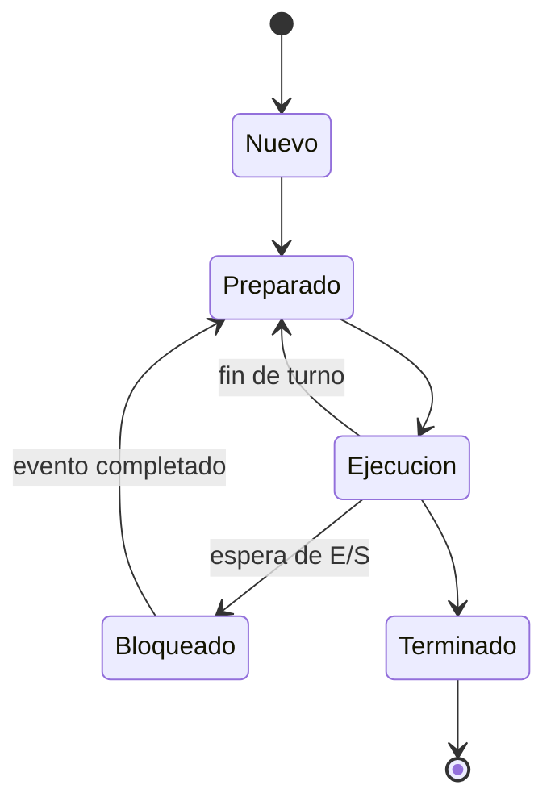
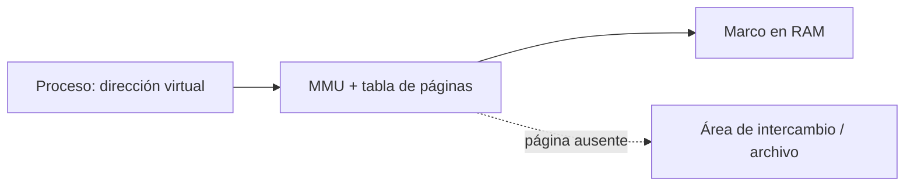
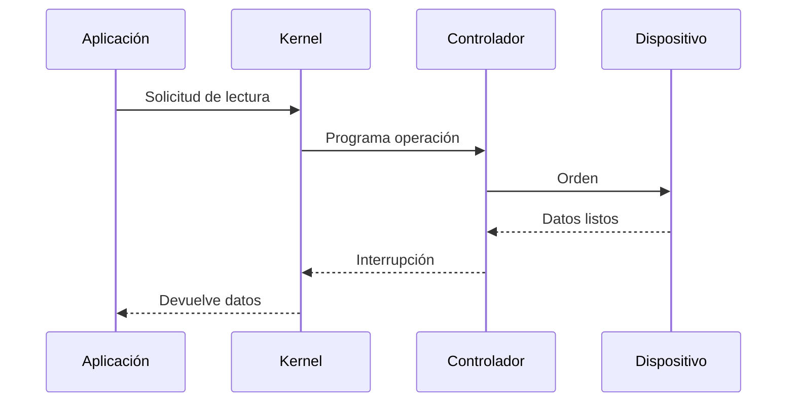

# 2. Procesos, memoria y entrada/salida

<div class="lesson-banner" markdown>
<div class="lesson-number">2.1</div>
<div markdown>
**Lo que ocurre cuando varios programas parecen funcionar a la vez**

Estudiaremos cómo el sistema operativo gestiona procesos, CPU, memoria,
archivos y dispositivos. Seguiremos ejemplos desde la apertura de una aplicación
hasta su finalización y compararemos Windows, GNU/Linux y macOS.
</div>
</div>

## 2.1 Programa, proceso e hilo

Un programa es un archivo con instrucciones. Un proceso es su ejecución con espacio de memoria, recursos, credenciales y estado. Un hilo es una línea de ejecución dentro del proceso; los hilos comparten memoria y recursos del proceso.



El planificador selecciona procesos preparados. Una conmutación de contexto guarda el estado de uno y restaura el de otro. Es necesaria para multitarea, pero tiene coste.

### Estados y datos que conserva el sistema

| Estado didáctico | Significado | Ejemplo |
|---|---|---|
| Nuevo | Se están creando sus estructuras y recursos | Se solicita abrir un editor |
| Preparado | Puede ejecutar, pero espera CPU | El editor espera su turno |
| En ejecución | Un hilo está usando un procesador lógico | Calcula el resaltado del código |
| Bloqueado o en espera | Necesita que ocurra un evento | Espera una lectura o un bloqueo |
| Terminado | Ha acabado su ejecución | El editor se ha cerrado |

El **PCB (bloque de control del proceso)** reúne información como PID, estado,
credenciales, referencias a memoria y archivos abiertos. El contexto de ejecución
incluye registros y contador de programa; en un proceso multihilo, cada hilo
necesita su propio contexto. Un proceso puede tener simultáneamente hilos
preparados y otros bloqueados: el diagrama anterior simplifica esa situación.

**Ejemplo:** un editor ejecuta código, solicita una lectura que no está en caché
y queda en espera. Cuando llegan los datos pasa a preparado; solo vuelve a
Ejecutar cuando el planificador le asigna CPU. Estar bloqueado no significa
necesariamente que la aplicación se haya averiado.

### Creación y finalización

1. Una aplicación, un servicio o el usuario solicita ejecutar un programa.
2. El SO crea las estructuras de control, asigna un PID y configura el espacio
   de direcciones, los permisos y los recursos iniciales.
3. Se prepara al menos un hilo para empezar a ejecutar. El ejecutable y sus
   bibliotecas pueden cargarse bajo demanda.
4. El proceso crea otros hilos o procesos si los necesita.
5. Al terminar, se registra un resultado y el SO recupera los recursos que le
   corresponden, como memoria y referencias a archivos abiertos.

En Windows, `CreateProcess` permite crear un proceso y su hilo inicial. En los
sistemas de tipo Unix se utiliza, entre otros mecanismos, `fork` para crear un
hijo y `exec` para sustituir la imagen del proceso por otro programa; `exec`
por sí solo no crea un nuevo proceso. También existe `posix_spawn`.

**Ejemplo:** una terminal lanza un compilador y espera su código de salida.
Si termina correctamente, puede lanzar el programa compilado. En Unix, un hijo
terminado pendiente de que se recoja su estado puede quedar como **zombi**:
conserva información de salida, pero ya no ejecuta instrucciones.

El cierre normal permite guardar datos y liberar recursos de la aplicación.
Una terminación forzada puede impedir esa limpieza. Un proceso también puede
finalizar por un error no recuperable o por una decisión del SO. Cerrar una
ventana no garantiza que hayan terminado todos los procesos de una aplicación.

<div class="video-card" markdown>

### Vídeo · Planificación de procesos — UTPL

Vídeo docente en español de la Universidad Técnica Particular de Loja,
canal **videoconferencias**, centrado en estados y planificación de procesos.
Sirve para relacionar los turnos de CPU con los ejemplos de este apartado;
los algoritmos didácticos no describen por sí solos todo un SO actual.

<div class="video-frame">
<iframe src="https://www.youtube-nocookie.com/embed/xQDi62YZuuw"
title="UTPL · Planificación de procesos en sistemas operativos" loading="lazy"
allowfullscreen></iframe>
</div>

[Abrir el vídeo en YouTube](https://www.youtube.com/watch?v=xQDi62YZuuw)

**Guía de visionado:** diferencia preparado y bloqueado, anota dos objetivos
del planificador y explica por qué una tarea corta puede esperar detrás de una
larga. Después, reproduce en papel el ejemplo Round Robin de este tema.

</div>

## 2.2 Multitarea, concurrencia y sincronización

Estas son **capacidades del sistema operativo y mecanismos de programación**;
no son, en general, opciones que el usuario deba activar en un menú.

- **Multitarea:** el SO reparte la CPU entre las tareas. En Windows, GNU/Linux
  y macOS es normalmente **apropiativa o expulsiva**: el sistema puede retirar
  la CPU a un hilo para ejecutar otro. El usuario no suele elegir entre
  multitarea apropiativa y cooperativa. En la **cooperativa**, la tarea debe
  ceder el control; si no lo hace, puede perjudicar a las demás. La multitarea
  no exige varios núcleos: con uno se pueden alternar tareas.
- **Concurrencia:** varias tareas avanzan durante el mismo periodo, aunque se
  vayan turnando en la CPU. Por ejemplo, mientras el navegador espera una
  respuesta de red, el editor puede usar CPU.
- **Paralelismo:** varias tareas ejecutan instrucciones simultáneamente si hay
  recursos de procesamiento disponibles y el trabajo puede aprovecharlos.
  El SO distribuye el trabajo; por ejemplo, dos compilaciones pueden ejecutarse
  a la vez en distintos núcleos. Tener diez aplicaciones abiertas no significa
  que las diez ejecuten instrucciones en el mismo instante.
- **Sincronización:** los programadores utilizan mecanismos como mutex,
  semáforos y operaciones atómicas, disponibles mediante servicios del SO y
  bibliotecas, para coordinar los hilos y proteger datos compartidos. Dos hilos
  que modifican un mismo dato sin la coordinación necesaria pueden sufrir una
  **condición de carrera**; un mal diseño de los bloqueos puede producir un
  **interbloqueo**.

**Ejemplo cotidiano:** tú abres el navegador y un editor; el SO organiza sus
turnos de CPU; y los desarrolladores de cada aplicación programan la
coordinación entre sus hilos.

### Ejemplo de carrera

Dos hilos leen un contador con valor 10, ambos suman uno y ambos escriben 11. Se esperaban dos incrementos, pero se obtiene uno. La operación “leer-modificar-escribir” debe protegerse como una unidad.

### Herramientas de sincronización y comunicación

| Mecanismo | Para qué sirve | Ejemplo |
|---|---|---|
| Mutex | Exclusión mutua en una sección crítica | Modificar un saldo compartido |
| Semáforo contador | Limitar accesos a un número de recursos | Tres conexiones disponibles para varios trabajadores |
| Variable de condición | Esperar un cambio y comprobar de nuevo una condición | Consumidor esperando una cola no vacía |
| Operación atómica | Realizar una operación indivisible | Incrementar un contador compartido |
| Tubería o cola de mensajes | Comunicar datos entre tareas | Enviar la salida de un programa a otro |

**Ejemplo productor-consumidor:** un hilo recibe datos de red y los deposita en
una cola; otro los procesa. Se protege la cola y el consumidor espera cuando
está vacía. Comunicar datos y proteger el acceso son necesidades relacionadas,
pero diferentes. La memoria compartida requiere coordinación explícita.

## 2.3 Planificación de CPU

### Cómo se reparte la CPU

En el modelo de un único núcleo con un hilo de hardware se ejecuta un hilo
cada vez. Los demás están preparados o esperan un evento. Un hilo bloqueado
por E/S no necesita consumir CPU continuamente para seguir esperando.

| Política didáctica | Criterio | Posible inconveniente |
|---|---|---|
| FCFS | Orden de llegada | Una tarea larga retrasa a las cortas |
| Round Robin | Turnos máximos llamados quantum | Turnos cortos aumentan cambios de contexto |
| Prioridades | Atiende primero a mayor prioridad | Puede dejar tareas esperando demasiado |

Ejemplo Round Robin: A necesita 5 ms de CPU y B necesita 3 ms. Llegan en el
instante 0, se atiende primero A y el quantum es 2 ms. No hay E/S ni otras
tareas y se ignora el coste de los cambios de contexto:

```text
Intervalo (ms): 0–2 | 2–4 | 4–6 | 6–7 | 7–8
Hilo:            A |   B |   A |   B |   A
```

B termina en el instante 7 y A en el 8. El **retorno** es fin menos llegada:
7 y 8 ms. Sin bloqueos, la **espera** es retorno menos ejecución: B espera
4 ms y A espera 3 ms. Los sistemas reales combinan mecanismos más complejos.

Una carrera puede producir un resultado incorrecto según el orden de acceso.
Un **interbloqueo** es diferente: A retiene un recurso y espera otro retenido
por B, mientras B espera el de A; ninguno progresa. Adquirir los bloqueos en
un orden común permite prevenir ese caso.

### Otro ejemplo: FCFS frente a tareas cortas

A necesita 8 ms y B necesita 2 ms; ambos llegan en 0 y A entra primero. Con
FCFS, A ocupa 0–8 y B ocupa 8–10: B espera 8 ms para responder por primera vez.
Con Round Robin de 2 ms, B recibe CPU en 2–4 y termina antes. Hay más cambios
de contexto: mejorar respuesta puede tener un coste.

La **respuesta** mide desde la llegada hasta la primera ejecución; el
**retorno**, hasta terminar. La planificación busca equilibrar respuesta,
productividad y equidad. SJF elige la ráfaga prevista más corta, pero necesita
estimarla y puede perjudicar trabajos largos. La prioridad no crea más CPU ni
resuelve un cuello de botella de disco.

## 2.4 Gestión de memoria

### Direcciones virtuales y RAM

Cada proceso ve un espacio de direcciones propio. La unidad de gestión de memoria traduce direcciones virtuales a marcos físicos mediante tablas de páginas.



Ventajas:

- aislamiento entre procesos;
- uso de direcciones continuas aunque la RAM esté fragmentada;
- compartición controlada;
- carga bajo demanda;
- posibilidad de apoyar RAM con almacenamiento.

Si el sistema intercambia páginas constantemente aparece *thrashing*: dedica más tiempo a mover datos que a ejecutar trabajo útil.

### Asignación y protección

El sistema marca páginas con permisos de lectura, escritura y ejecución. La protección NX impide ejecutar regiones destinadas a datos. La aleatorización del espacio de direcciones dificulta determinados ataques, aunque no corrige vulnerabilidades.

La memoria usada no equivale siempre a memoria perdida. Los sistemas aprovechan RAM libre como caché y pueden liberarla si una aplicación la necesita.

### Reserva, uso, liberación y reemplazo

El SO gestiona espacio virtual y páginas físicas; el entorno de ejecución o
el asignador de la aplicación reparte memoria dentro del proceso. Reservar
espacio virtual no implica ocupar inmediatamente la misma cantidad de RAM.
El código, los datos, la pila de cada hilo y el montón (*heap*) cumplen
funciones distintas dentro de ese espacio.

Cuando se necesitan marcos, el SO puede recuperar caché o reemplazar páginas.
Una página limpia respaldada por un archivo puede descartarse y releerse; una
página modificada puede requerir escritura antes de reutilizar su marco.
FIFO y LRU son modelos didácticos de reemplazo; las implementaciones reales
usan aproximaciones y otras políticas. No hay que confundirlos con los
algoritmos que reparten CPU.

**Ejemplo:** con tres marcos y referencias `1, 2, 3, 1, 4`, al pedir 4 todos
están ocupados. FIFO sustituye 1, que entró primero; LRU sustituye 2, que lleva
más tiempo sin usarse. El ejemplo ignora páginas fijadas y otros detalles reales.

**Ejemplo de fuga:** una aplicación reserva memoria repetidamente y pierde
las referencias necesarias para reutilizarla o liberarla. El crecimiento
persistente merece investigarse; una única medición alta no demuestra una fuga.
Al terminar el proceso, el SO recupera su memoria privada.

## 2.5 Gestión de entrada/salida

Muchas operaciones de dispositivos tienen latencias mucho mayores que una operación de CPU. El sistema usa interrupciones, búferes, cachés, colas y acceso directo a memoria.



Una operación síncrona puede bloquear al hilo hasta finalizar. En modelos asíncronos, el proceso continúa y recibe una notificación posterior.

Un **búfer** absorbe diferencias de ritmo entre productor y consumidor; una
**caché** conserva copias para acelerar accesos repetidos; un **spool** mantiene
trabajos en una cola, como documentos pendientes de impresión. Son funciones
distintas que pueden coexistir.

### Interrupciones, DMA y espera

Con **sondeo**, el software consulta si el dispositivo está listo. Una
**interrupción** notifica un evento para que la CPU lo atienda. El **DMA** permite
transferir bloques entre dispositivo y memoria sin que la CPU copie cada byte;
la CPU y el controlador siguen configurando y supervisando la operación.

Una llamada **bloqueante** puede dejar al hilo esperando. Una llamada **no
bloqueante** vuelve inmediatamente aunque aún no haya datos. La E/S **asíncrona**
permite recibir después el resultado de una operación pendiente. Son conceptos
relacionados, pero no equivalentes.

**Ejemplos:** el búfer de audio absorbe variaciones en la llegada de muestras;
la caché de archivos evita repetir lecturas; el spool de impresión conserva
trabajos mientras la impresora atiende el anterior. Una descarga lenta puede
dejar muchos hilos esperando con poco uso de CPU.

## 2.6 Gestión de archivos

El sistema de archivos organiza nombres, directorios, contenido y metadatos
(tamaño, permisos y fechas). La aplicación solicita operaciones como crear,
abrir, leer, escribir, reposicionar, cerrar, renombrar o borrar. El SO comprueba
permisos y proporciona un descriptor o manejador para acceder al archivo abierto.

| Operación | Trabajo del SO | Ejemplo |
|---|---|---|
| Abrir | Resolver la ruta y comprobar acceso | Abrir el código fuente en el IDE |
| Leer | Obtener datos de caché o almacenamiento | Cargar una imagen |
| Escribir | Modificar datos y gestionar su escritura | Guardar un documento |
| Cerrar | Liberar la referencia al archivo abierto | Finalizar una exportación |
| Renombrar o borrar | Modificar nombres y metadatos según las reglas del sistema | Sustituir un archivo temporal |

**Ejemplo: guardar desde un editor.** El editor entrega datos al SO, que puede
mantenerlos en caché antes de enviarlos al dispositivo. Una escritura aceptada
no garantiza por sí sola persistencia ante un corte eléctrico; las aplicaciones
que lo necesitan solicitan sincronización. Cerrar un archivo no equivale siempre
a forzar toda la información al soporte físico.

**Ejemplo de acceso concurrente:** dos procesos leen el mismo inventario y
escriben modificaciones incompatibles. Un permiso de escritura autoriza el
acceso, pero no evita una carrera: hacen falta bloqueos o transacciones según
la aplicación. El journaling ayuda a recuperar la coherencia del sistema de
archivos; no sustituye una copia de seguridad.

## 2.7 Gestión de dispositivos

El SO identifica dispositivos, carga o utiliza sus **controladores (drivers)**,
administra solicitudes y errores y controla quién puede acceder. Un controlador
es software; no debe confundirse con la controladora física del dispositivo.
No todos los dispositivos se representan como archivos ordinarios ni todos los
controladores son procesos independientes visibles en el monitor del sistema.

| Dispositivo | Qué gestiona el SO | Situación de aula |
|---|---|---|
| SSD o disco | Solicitudes de bloques, colas y errores | Varias aplicaciones leen a la vez |
| Teclado y ratón | Eventos de entrada y su entrega | Escribir mientras se copia un archivo |
| Tarjeta de red | Recepción, transmisión y búferes | Descargar mientras se realiza una videollamada |
| Impresora | Trabajos, permisos y estados de error | Un trabajo espera por falta de papel |
| GPU | Recursos gráficos y envío de trabajo | El escritorio y una aplicación usan aceleración |
| Unidad USB | Detección, acceso y retirada | Expulsarla tras completar escrituras pendientes |

**Ejemplo completo: conectar una memoria USB.** El sistema detecta el dispositivo,
lo asocia con un controlador y reconoce sus volúmenes. Si monta un sistema de
archivos compatible, las aplicaciones pueden acceder a él según sus permisos.
Al copiar, intervienen procesos, memoria, caché, archivos, E/S y el controlador.
La expulsión segura permite completar operaciones pendientes antes de retirarlo.

### Un caso que reúne todos los gestores

Al imprimir un PDF, el visor ejecuta hilos y usa memoria para interpretar páginas;
abre el archivo, lee su contenido y envía un trabajo al servicio de impresión.
El spool mantiene el trabajo, el controlador prepara la comunicación con la
impresora y el planificador deja que otras aplicaciones usen CPU durante las
esperas. El visor puede cerrarse y el servicio continuar imprimiendo.

## 2.8 Observación práctica

En Linux:

```bash
ps -eo pid,ppid,stat,ni,%cpu,%mem,comm
free -h
vmstat 1
```

En PowerShell:

```powershell
Get-Process | Sort-Object CPU -Descending | Select-Object -First 10
Get-CimInstance Win32_OperatingSystem |
  Select-Object TotalVisibleMemorySize,FreePhysicalMemory
```

Los datos deben interpretarse durante un periodo y bajo una carga conocida. Un pico breve no implica un problema.

<div class="activity-card" markdown>

## :material-chart-line: Tarea 2.2 · Comparativa de gestión de procesos

<div class="activity-meta" markdown>
<span>110 min</span><span>Individual</span><span>Entrega en Aules</span>
</div>

Compararás Windows, GNU/Linux y macOS: estados de proceso, planificación,
creación y finalización, sincronización y multitarea. Relacionarás sus mecanismos
con memoria, archivos y dispositivos mediante casos concretos.

[Abrir la actividad comparativa](actividades/A2-observatorio-procesos.md){ .md-button .md-button--primary }

</div>

## Caso razonado

Un equipo tiene CPU al 15 %, RAM al 95 % y disco al 100 % mientras cambia lentamente entre aplicaciones. La hipótesis principal es presión de memoria con paginación. Antes de ampliar RAM se identifica qué procesos crecen, si existe fuga, qué carga es normal y cuánto intercambio se produce.

<div class="activity-card" markdown>

## :material-stethoscope: Tarea 2.1.1 · Diagnóstico de rendimiento

<div class="activity-meta" markdown>
<span>50 min</span><span>Individual</span><span>Entrega en Aules</span>
</div>

Resolverás un caso de lentitud distinguiendo síntomas de CPU, memoria, disco y
paginación.

[Abrir la actividad de diagnóstico](actividades/A21-diagnostico-rendimiento.md){ .md-button .md-button--primary }

</div>

## Ejemplo resuelto: traducir una dirección virtual

Supongamos páginas de **4 KiB = 4 096 bytes** y direcciones expresadas en bytes.
La dirección virtual `13 500` se descompone así:

1. Número de página: `13 500 ÷ 4 096`, cociente **3**.
2. Desplazamiento: `13 500 - 3 × 4 096 = 1 212` bytes.
3. Si la tabla asigna la página 3 al marco físico 9, la dirección física es
   `9 × 4 096 + 1 212 = 38 076`.

El desplazamiento se conserva; cambia la base del marco. Es un modelo
didáctico: las CPU reales emplean tablas multinivel y una caché de traducciones
llamada **TLB**.

Un fallo de TLB requiere buscar la traducción; no significa por sí solo que
haya que leer el disco. Un **fallo de página** tampoco implica siempre
intercambio: puede resolverse asignando una página nueva o usando datos ya
presentes en memoria. Si el acceso viola permisos, el sistema puede terminar
el proceso en vez de cargar una página.

### Interpretar la medida de CPU

La propiedad `CPU` de `Get-Process` acumula **segundos de procesador** desde el
inicio del proceso. Ordenarla permite ver consumo acumulado, pero no identifica
necesariamente qué proceso consume más en este instante. Para estudiar un pico,
observa una serie temporal en el Administrador de tareas o compara dos muestras
del mismo PID. Anota intervalo y número de procesadores lógicos para interpretar
el porcentaje.

Ejemplo: consumir 2 segundos de CPU en un intervalo de 4 segundos equivale al
50 % de un procesador lógico. En un equipo con 4 procesadores lógicos representa
el 12,5 % de la capacidad lógica total. Las herramientas pueden usar escalas
distintas: indica qué comparas.

Referencia: [Get-Process y CPU(s)](https://learn.microsoft.com/en-us/powershell/module/microsoft.powershell.management/get-process).

## Comprobación

1. Diferencia programa, proceso e hilo.
2. Explica por qué la memoria virtual mejora aislamiento.
3. ¿Qué indica un equipo con baja CPU pero disco saturado durante paginación?

### Autoevaluación razonada

- **¿Preparado y bloqueado compiten ahora por CPU?** El preparado puede ser
  seleccionado; el bloqueado debe esperar al evento correspondiente.
- **¿Memoria virtual significa RAM instalada?** No: espacio de direcciones
  virtuales y memoria física son conceptos diferentes.
- **¿RAM usada alta demuestra una fuga?** No: puede incluir caché reutilizable.
  Observa memoria disponible, crecimiento por proceso y paginación.

## Fuentes para ampliar y comprobar datos

- [Microsoft Learn · Procesos e hilos](https://learn.microsoft.com/en-us/windows/win32/procthread/about-processes-and-threads).
- [Linux · Planificador EEVDF](https://docs.kernel.org/scheduler/sched-eevdf.html): comprobar siempre la versión del kernel estudiada.
- [Apple · Mach Overview](https://developer.apple.com/library/archive/documentation/Darwin/Conceptual/KernelProgramming/Mach/Mach.html): documentación de archivo para los fundamentos; no describe todos los detalles del macOS actual.
- [Manual Linux · fork](https://man7.org/linux/man-pages/man2/fork.2.html), [execve](https://man7.org/linux/man-pages/man2/execve.2.html) y [wait](https://man7.org/linux/man-pages/man2/wait.2.html).
