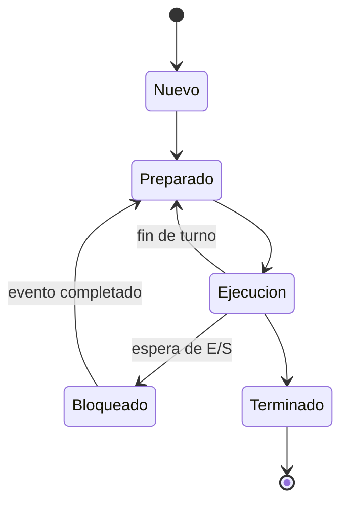
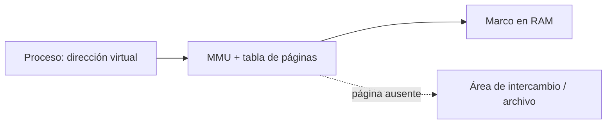
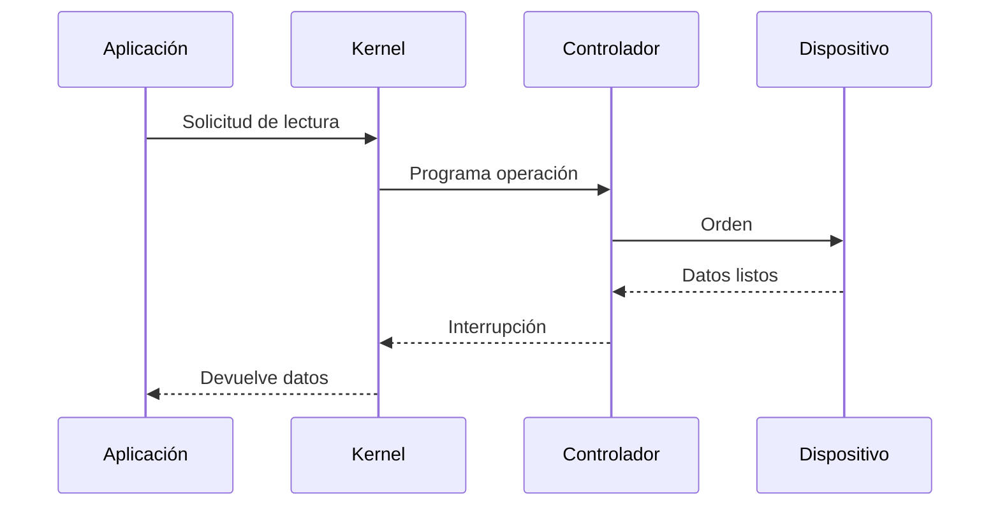

# 2. Procesos, memoria y entrada/salida

<div class="lesson-banner" markdown>
<div class="lesson-number">2.1</div>
<div markdown>
**Lo que ocurre cuando varios programas parecen funcionar a la vez**

Estudiaremos procesos, hilos, memoria virtual y entrada/salida para interpretar
un equipo real antes de proponer soluciones de rendimiento.
</div>
</div>

## 2.1 Programa, proceso e hilo

Un programa es un archivo con instrucciones. Un proceso es su ejecución con espacio de memoria, recursos, credenciales y estado. Un hilo es una línea de ejecución dentro del proceso; los hilos comparten memoria y recursos del proceso.



El planificador selecciona procesos preparados. Una conmutación de contexto guarda el estado de uno y restaura el de otro. Es necesaria para multitarea, pero tiene coste.

<div class="video-card" markdown>

### Vídeo · Procesos y administración de memoria

Repaso en español de los conceptos de gestión de memoria en sistemas
operativos. Úsalo como apoyo para distinguir memoria física, memoria virtual,
asignación y paginación antes de interpretar mediciones reales.

<div class="video-frame">
<iframe src="https://www.youtube-nocookie.com/embed/k9Pa3rTWk6s"
title="Administración de memoria en sistemas operativos" loading="lazy"
allowfullscreen></iframe>
</div>

[Abrir el vídeo en YouTube](https://www.youtube.com/watch?v=k9Pa3rTWk6s)

</div>

## 2.2 Concurrencia y paralelismo

Concurrencia significa que varias tareas progresan durante el mismo intervalo. Paralelismo significa que se ejecutan literalmente al mismo tiempo en distintos núcleos.

Dos hilos que modifican un dato compartido pueden sufrir una condición de carrera. Los mecanismos de sincronización —mutex, semáforos y operaciones atómicas— coordinan el acceso, pero un mal diseño puede producir interbloqueo.

### Ejemplo de carrera

Dos hilos leen un contador con valor 10, ambos suman uno y ambos escriben 11. Se esperaban dos incrementos, pero se obtiene uno. La operación “leer-modificar-escribir” debe protegerse como una unidad.

## 2.3 Memoria virtual

### Cómo se reparte la CPU

En el modelo de un único núcleo con un hilo de hardware se ejecuta un hilo
cada vez. Los demás están preparados o esperan un evento. Un hilo bloqueado
por E/S no necesita consumir CPU continuamente para seguir esperando.

| Política didáctica | Criterio | Posible inconveniente |
|---|---|---|
| FCFS | Orden de llegada | Una tarea larga retrasa a las cortas |
| Round Robin | Turnos máximos llamados quantum | Turnos cortos aumentan cambios de contexto |
| Prioridades | Atiende primero a mayor prioridad | Puede dejar tareas esperando demasiado |

Ejemplo Round Robin: A necesita 5 ms de CPU y B necesita 3 ms. Llegan en el
instante 0, se atiende primero A y el quantum es 2 ms. No hay E/S ni otras
tareas y se ignora el coste de los cambios de contexto:

```text
Intervalo (ms): 0–2 | 2–4 | 4–6 | 6–7 | 7–8
Hilo:            A |   B |   A |   B |   A
```

B termina en el instante 7 y A en el 8. El **retorno** es fin menos llegada:
7 y 8 ms. Sin bloqueos, la **espera** es retorno menos ejecución: B espera
4 ms y A espera 3 ms. Los sistemas reales combinan mecanismos más complejos.

Una carrera puede producir un resultado incorrecto según el orden de acceso.
Un **interbloqueo** es diferente: A retiene un recurso y espera otro retenido
por B, mientras B espera el de A; ninguno progresa. Adquirir los bloqueos en
un orden común permite prevenir ese caso.

### Direcciones virtuales y RAM

Cada proceso ve un espacio de direcciones propio. La unidad de gestión de memoria traduce direcciones virtuales a marcos físicos mediante tablas de páginas.



Ventajas:

- aislamiento entre procesos;
- uso de direcciones continuas aunque la RAM esté fragmentada;
- compartición controlada;
- carga bajo demanda;
- posibilidad de apoyar RAM con almacenamiento.

Si el sistema intercambia páginas constantemente aparece *thrashing*: dedica más tiempo a mover datos que a ejecutar trabajo útil.

## 2.4 Asignación y protección

El sistema marca páginas con permisos de lectura, escritura y ejecución. La protección NX impide ejecutar regiones destinadas a datos. La aleatorización del espacio de direcciones dificulta determinados ataques, aunque no corrige vulnerabilidades.

La memoria usada no equivale siempre a memoria perdida. Los sistemas aprovechan RAM libre como caché y pueden liberarla si una aplicación la necesita.

## 2.5 Entrada/salida

Los dispositivos son mucho más lentos que la CPU. El sistema usa interrupciones, búferes, cachés, colas y acceso directo a memoria.



Una operación síncrona puede bloquear al hilo hasta finalizar. En modelos asíncronos, el proceso continúa y recibe una notificación posterior.

Un **búfer** absorbe diferencias de ritmo entre productor y consumidor; una
**caché** conserva copias para acelerar accesos repetidos; un **spool** mantiene
trabajos en una cola, como documentos pendientes de impresión. Son funciones
distintas que pueden coexistir.

## 2.6 Observación práctica

En Linux:

```bash
ps -eo pid,ppid,stat,ni,%cpu,%mem,comm
free -h
vmstat 1
```

En PowerShell:

```powershell
Get-Process | Sort-Object CPU -Descending | Select-Object -First 10
Get-CimInstance Win32_OperatingSystem |
  Select-Object TotalVisibleMemorySize,FreePhysicalMemory
```

Los datos deben interpretarse durante un periodo y bajo una carga conocida. Un pico breve no implica un problema.

<div class="activity-card" markdown>

## :material-chart-line: Tarea 2.2 · Observatorio de procesos y memoria

<div class="activity-meta" markdown>
<span>60 min</span><span>Individual</span><span>Entrega en Aules</span>
</div>

Medirás el estado del equipo antes y después de abrir una carga real de clase,
comparando CPU, memoria, disco y procesos.

[Abrir la actividad de observación](actividades/A2-observatorio-procesos.md){ .md-button .md-button--primary }

</div>

## Caso razonado

Un equipo tiene CPU al 15 %, RAM al 95 % y disco al 100 % mientras cambia lentamente entre aplicaciones. La hipótesis principal es presión de memoria con paginación. Antes de ampliar RAM se identifica qué procesos crecen, si existe fuga, qué carga es normal y cuánto intercambio se produce.

<div class="activity-card" markdown>

## :material-stethoscope: Tarea 2.1.1 · Diagnóstico de rendimiento

<div class="activity-meta" markdown>
<span>50 min</span><span>Individual</span><span>Entrega en Aules</span>
</div>

Resolverás un caso de lentitud distinguiendo síntomas de CPU, memoria, disco y
paginación.

[Abrir la actividad de diagnóstico](actividades/A21-diagnostico-rendimiento.md){ .md-button .md-button--primary }

</div>

## Ejemplo resuelto: traducir una dirección virtual

Supongamos páginas de **4 KiB = 4 096 bytes** y direcciones expresadas en bytes.
La dirección virtual `13 500` se descompone así:

1. Número de página: `13 500 ÷ 4 096`, cociente **3**.
2. Desplazamiento: `13 500 - 3 × 4 096 = 1 212` bytes.
3. Si la tabla asigna la página 3 al marco físico 9, la dirección física es
   `9 × 4 096 + 1 212 = 38 076`.

El desplazamiento se conserva; cambia la base del marco. Es un modelo
didáctico: las CPU reales emplean tablas multinivel y una caché de traducciones
llamada **TLB**.

Un fallo de TLB requiere buscar la traducción; no significa por sí solo que
haya que leer el disco. Un **fallo de página** tampoco implica siempre
intercambio: puede resolverse asignando una página nueva o usando datos ya
presentes en memoria. Si el acceso viola permisos, el sistema puede terminar
el proceso en vez de cargar una página.

### Interpretar la medida de CPU

La propiedad `CPU` de `Get-Process` acumula **segundos de procesador** desde el
inicio del proceso. Ordenarla permite ver consumo acumulado, pero no identifica
necesariamente qué proceso consume más en este instante. Para estudiar un pico,
observa una serie temporal en el Administrador de tareas o compara dos muestras
del mismo PID. Anota intervalo y número de procesadores lógicos para interpretar
el porcentaje.

Ejemplo: consumir 2 segundos de CPU en un intervalo de 4 segundos equivale al
50 % de un procesador lógico. En un equipo con 4 procesadores lógicos representa
el 12,5 % de la capacidad lógica total. Las herramientas pueden usar escalas
distintas: indica qué comparas.

Referencia: [Get-Process y CPU(s)](https://learn.microsoft.com/en-us/powershell/module/microsoft.powershell.management/get-process).

## Comprobación

1. Diferencia programa, proceso e hilo.
2. Explica por qué la memoria virtual mejora aislamiento.
3. ¿Qué indica un equipo con baja CPU pero disco saturado durante paginación?

### Autoevaluación razonada

- **¿Preparado y bloqueado compiten ahora por CPU?** El preparado puede ser
  seleccionado; el bloqueado debe esperar al evento correspondiente.
- **¿Memoria virtual significa RAM instalada?** No: espacio de direcciones
  virtuales y memoria física son conceptos diferentes.
- **¿RAM usada alta demuestra una fuga?** No: puede incluir caché reutilizable.
  Observa memoria disponible, crecimiento por proceso y paginación.

## Fuentes para ampliar y comprobar datos

- [Microsoft Learn · Requisitos de Windows 11](https://learn.microsoft.com/es-es/windows/whats-new/windows-11-requirements):
  mínimos de memoria, almacenamiento y requisitos en máquinas virtuales.
- [Ubuntu · Documentación de actualizaciones de seguridad](https://documentation.ubuntu.com/security/security-updates/):
  cómo se entregan actualizaciones de seguridad dentro de una ventana de soporte.
