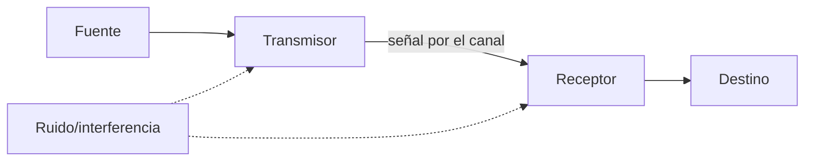
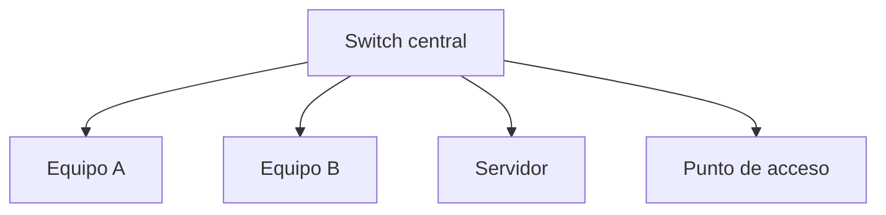

# 3.1 · Comunicación, medios y dispositivos

## 3.1.1 Elementos de comunicación

El mensaje debe codificarse en señales adecuadas al canal. En cobre son variaciones eléctricas; en fibra, luz; en Wi-Fi, ondas electromagnéticas. El receptor reconstruye bits, pero debe compartir protocolos y código.

## 3.1.2 Magnitudes

- **Ancho de banda:** capacidad nominal en bit/s.
- **Throughput:** datos útiles logrados.
- **Latencia:** tiempo de extremo a extremo.
- **Jitter:** variación de latencia.
- **Pérdida:** unidades que no llegan.

Copiar 1 GiB por un enlace de 100 Mbit/s no tarda 10 segundos. `1 GiB = 8.589.934.592 bits`; el mínimo teórico ronda 85,9 s y la sobrecarga aumenta el tiempo.

## 3.1.3 Medios guiados

El par trenzado reduce interferencia mediante torsión y transmisión diferencial. Categoría, longitud, conectores y calidad del montaje determinan prestaciones. Ethernet de cobre suele limitar el tramo horizontal a 100 m en condiciones estándar.

La fibra transmite luz, ofrece gran capacidad, distancia e inmunidad electromagnética. Monomodo y multimodo usan ópticas y alcances distintos; conectores y limpieza son críticos.

## 3.1.4 Wi-Fi

Wi-Fi comparte medio: los clientes compiten por tiempo de aire. La velocidad anunciada es física y agregada; distancia, obstáculos, interferencias, canal, ancho y número de clientes reducen rendimiento.

Bandas de 2,4 GHz ofrecen alcance y congestión; 5/6 GHz aportan más canales y capacidad con menor penetración. La planificación usa mediciones, no solo intensidad de señal.

## 3.1.5 Topologías

La estrella facilita aislamiento de fallos de cable. Topología física describe conexiones; lógica, cómo circula información.

## 3.1.6 Dispositivos

- Un **repetidor** regenera señal.
- Un **switch** aprende MAC y conmuta tramas.
- Un **router** decide siguiente salto entre redes IP.
- Un **punto de acceso** puentea clientes inalámbricos.
- Un **firewall** aplica política.
- Una **ONT/módem** adapta el acceso del proveedor.

### Ejemplo

Un PC de una LAN quiere acceder a Internet. Envía la trama al MAC de la puerta de enlace, no al MAC del servidor remoto. El router elimina la trama local, examina IP y crea una nueva trama para el siguiente enlace.

## 3.1.7 Dúplex y conmutación

En full dúplex ambos extremos transmiten simultáneamente. En redes Ethernet con switches modernos no deberían existir colisiones en el enlace. Una discrepancia de velocidad o dúplex puede causar errores y rendimiento anómalo.

## Clasificar sin confundir criterios

PAN describe un entorno personal; LAN, una red local; MAN y WAN, ámbitos de interconexión más amplios. El alcance no se define únicamente por un límite rígido de edificio o ciudad. WLAN es una LAN inalámbrica: «local» y «Wi-Fi» son clasificaciones compatibles.

Cliente-servidor describe los papeles de una aplicación: un equipo solicita y otro presta un servicio. Una red puede tener varios servidores y un mismo equipo puede ser cliente de un servicio y servidor de otro. Entre iguales significa que los participantes pueden asumir ambos papeles; no obliga a que todos estén físicamente conectados con todos.

Simplex, half dúplex y full dúplex describen sentidos y simultaneidad de transmisión. Se aplican al enlace o mecanismo estudiado: «Internet es full dúplex» no sustituye al análisis de sus enlaces. Bus y anillo sirven como comparación histórica; la estrella con switches es el ejemplo inicial de aula.

Un hub repite señales hacia los demás puertos. Un switch aprende direcciones MAC y puede reenviar unicast por un solo puerto, pero también inunda broadcast y destinos desconocidos dentro del dominio correspondiente. No distribuye siempre todas las tramas a todos los equipos.

[Actividad 3.1](actividades/A1-red-del-aula.md) · [Práctica P1](practicas/P1-inspeccion.md)

## Actividad y aplicación práctica

- [Actividad 3.1 · Comprender una red](actividades/A1-red-del-aula.md)

Encontrarás los pasos prácticos asociados junto al enunciado de la actividad. Incorpora sus evidencias al mismo PDF y entrega todo junto en la tarea de Aules correspondiente.
