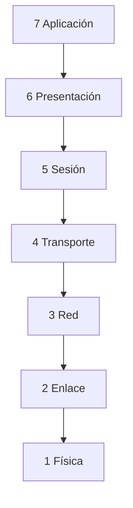
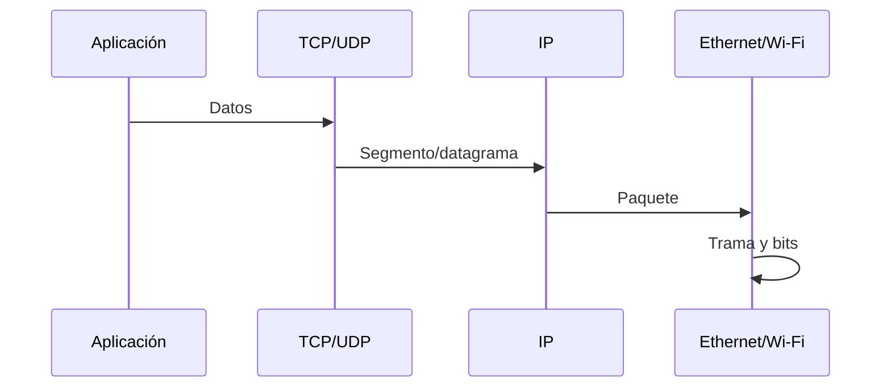
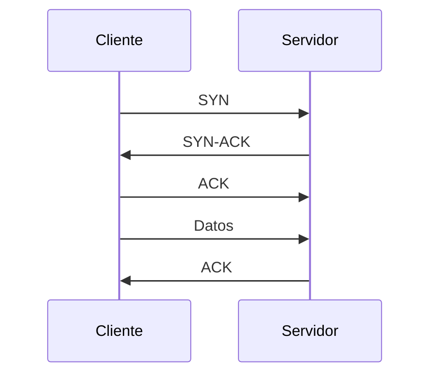
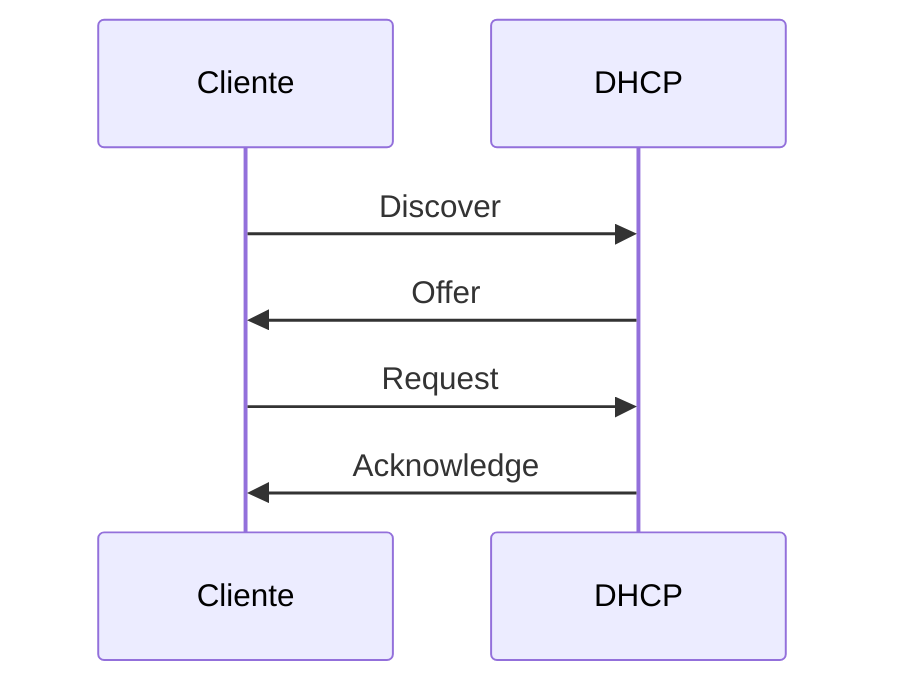

# 3.2 · Modelos, Ethernet y protocolos

Cuando abres una web, el navegador no envía directamente señales por el cable. El sistema prepara datos de aplicación, transporte, red y enlace. Este reparto permite cambiar una tecnología sin tener que rediseñar todas las demás. En este bloque seguirás una petición y aprenderás a reconocer sus partes en una captura.

## 3.2.1 Capas

El modelo OSI organiza funciones; TCP/IP refleja la pila utilizada en Internet. Las capas ayudan a explicar y diagnosticar, pero implementaciones reales pueden cruzar límites.

Cada capa resuelve un problema y utiliza los servicios de la inferior. La aplicación pide intercambiar datos; transporte organiza la comunicación entre extremos; red permite atravesar distintas redes; enlace y física permiten el intercambio en cada tramo. OSI sirve como referencia conceptual y TCP/IP agrupa esas funciones de otra manera.

| OSI | TCP/IP en cuatro capas | Pregunta que resuelve | Ejemplo |
| --- | --- | --- | --- |
| Aplicación, presentación y sesión | Aplicación | ¿Qué mensajes intercambia el servicio? | HTTP, DNS; TLS protege comunicaciones |
| Transporte | Transporte | ¿Entre qué puntos de comunicación se envían los datos? | TCP, UDP y puertos |
| Red | Internet | ¿A qué dirección IP y por qué ruta? | IPv4, IPv6, ICMP |
| Enlace y física | Acceso a red | ¿Cómo llega al siguiente equipo del enlace? | Ethernet, Wi-Fi, MAC y señales |

No necesitas memorizar una lista sin contexto: ante un fallo, relaciona la función afectada con una comprobación. Un cable sin enlace y una consulta DNS sin respuesta requieren investigaciones distintas.

## 3.2.2 Encapsulación

Cada capa añade cabecera. En el destino se verifica y elimina en orden inverso.

En Ethernet también se añade un campo final de comprobación. Un segmento TCP contiene puertos y datos; un paquete IP contiene las direcciones IP y ese segmento; una trama Ethernet contiene las MAC y el paquete. Encapsular significa introducir una unidad dentro de otra con información de control.

Imagina un cliente `192.168.50.20/24` que contacta con un servidor de otra red. El paquete lleva la IP del servidor, mientras que la primera trama lleva la MAC de la puerta de enlace. La IP indica el destino del recorrido; la MAC de esa trama indica el siguiente receptor del enlace. En el router se retira la trama y se crea otra para el enlace siguiente. Sin NAT, las direcciones IP de los extremos se conservan, aunque cambian otros campos como TTL.

## 3.2.3 Ethernet y MAC

Una dirección MAC identifica una interfaz en el dominio de enlace. El switch aprende la MAC de origen asociada al puerto. Si desconoce destino, inunda dentro de la VLAN; cuando aprende, reenvía solo por el puerto adecuado.

ARP resuelve qué MAC corresponde a una IPv4 local. La consulta ARP es broadcast; la respuesta permite enviar la trama.

El equipo decide primero si la IP de destino es local. Si lo es, busca la MAC de ese destino; si debe usar la puerta de enlace, busca la MAC de la puerta. No pregunta por ARP la MAC de un servidor que está al otro lado de Internet.

El switch aprende mirando la MAC de origen de las tramas que recibe. Al principio puede desconocer un destino y reenviar por los demás puertos de la VLAN. Esa inundación no lo convierte en un hub: conserva una tabla de aprendizaje y, cuando conoce la ubicación, puede seleccionar un puerto.

## 3.2.4 IP e ICMP

IP ofrece entrega de paquetes sin conexión y mejor esfuerzo. Cada router reduce TTL; si llega a cero, envía ICMP de tiempo excedido. Esto permite a `traceroute` descubrir saltos.

ICMP informa errores y diagnóstico. Bloquearlo completamente puede romper mecanismos útiles, incluida detección de MTU.

## 3.2.5 TCP

TCP establece conexión mediante intercambio inicial, numera bytes, confirma recepción, retransmite pérdidas y regula flujo y congestión.

Un puerto identifica un punto de comunicación del transporte; la asociación con un proceso o servicio depende de la configuración del sistema. La conexión se distingue por IP y puerto de ambos extremos más protocolo.

El cliente suele usar un puerto de origen temporal y el servidor escucha en un puerto del servicio, por ejemplo TCP 443 para HTTPS. Varios clientes pueden usar el mismo servicio porque cada comunicación se distingue por sus extremos.

TCP presenta a la aplicación un flujo ordenado de bytes. Si faltan datos puede retransmitirlos; no garantiza que la aplicación remota acepte una contraseña o que complete una operación. El control de flujo evita desbordar al receptor y el de congestión adapta el envío a la situación de la red.

## 3.2.6 UDP

UDP envía datagramas sin establecimiento, confirmación ni orden. Es útil cuando la aplicación tolera pérdida, implementa su propio control o prioriza latencia. DNS, voz o juegos pueden usarlo, aunque protocolos modernos añaden mecanismos sobre UDP.

UDP conserva los límites de cada datagrama y añade pocos mecanismos. No sería correcto concluir que una aplicación sobre UDP nunca retransmite: puede implementar ese comportamiento por encima. Elegir TCP o UDP depende del protocolo de aplicación, no de una decisión manual del alumno al visitar una web.

## 3.2.7 DNS y DHCP

DNS es jerárquico y traduce nombres. Una consulta puede pasar por caché, resolutor y servidores autoritativos.

DHCP suele seguir DORA:

La concesión incluye dirección, máscara, puerta, DNS y duración.

DHCP responde a «¿qué configuración de red puede usar esta interfaz?». DNS responde a «¿qué datos corresponden a este nombre?», por ejemplo una dirección A o AAAA. Obtener dirección por DHCP y resolver un nombre son operaciones diferentes: una puede funcionar y la otra fallar.

La información obtenida se guarda temporalmente. Una concesión se renueva y una respuesta DNS puede utilizarse desde caché mientras sea válida. Por eso una captura iniciada después de abrir el navegador puede no mostrar DORA ni una consulta DNS nueva.

## Caso de diagnóstico

`ping 1.1.1.1` funciona, pero `ping example.com` no. Enlace, IP y ruta parecen operativos; se investiga DNS. Esto demuestra el valor de separar capas.

## Qué permite concluir cada prueba

DNS puede usar UDP o TCP; no se clasifica todo el servicio como «solo UDP». Una conexión web puede usar TCP o, en HTTP/3, QUIC sobre UDP. La ausencia de un intercambio esperado puede deberse a caché, reutilización o un protocolo distinto.

Un protocolo define reglas, mensajes y comportamiento entre participantes. Un servicio es una función ofrecida; una implementación concreta realiza esas reglas. La analogía de capas permite diagnosticar, pero no significa que cada programa real corresponda exactamente a una sola capa OSI.

Fuente: [Guía oficial de Wireshark](https://www.wireshark.org/docs/wsug_html_chunked/ChapterIntroduction.html).

## Ejemplo guiado · Leer tres paquetes

1. En una consulta ARP, localiza la IP preguntada. Si la comunicación es remota, debería corresponder al siguiente salto local, no al servidor final.
2. En una consulta DNS, diferencia nombre consultado de dirección del servidor DNS. La respuesta puede aportar una dirección del destino.
3. En un SYN TCP, identifica IP y puerto de origen y destino. En el SYN-ACK busca esos extremos intercambiados.

La captura sintética de P4 termina tras el establecimiento TCP. Permite estudiar esos intercambios, pero no demostrar una descarga web ni leer contenido HTTPS.

**Comprueba que lo entiendes:** si un paquete IP cruza un router sin NAT, ¿por qué puede mantener sus IP y aparecer dentro de una trama con MAC diferentes?

## Vídeo de apoyo · Redes de ordenadores. Modelo OSI · UPV

Explicación en castellano del modelo por capas, publicada por la Universitat Politècnica de València. Utilízala para relacionar funciones y recorrido de datos.

[Ver el vídeo en el portal de su autor](https://www.upv.es/visor/media/3412b490-916e-11e6-b939-c9137fe7999d/v)

**Durante el visionado:** asocia aplicación, transporte, red y enlace con las preguntas de la tabla. Después coloca IP, MAC y puertos en el nivel adecuado.

## Ahora aplica lo aprendido

[Actividad 3.2 + P4 · Seguir una petición y leer una captura](actividades/A2-capas-y-recorrido.md).

La actividad y los pasos de Wireshark están en la misma página. Incorpora los paquetes comentados y las capturas al PDF `UD3_A2_Codigo.pdf`; adjunta el archivo de captura solicitado en la misma tarea de Aules.
