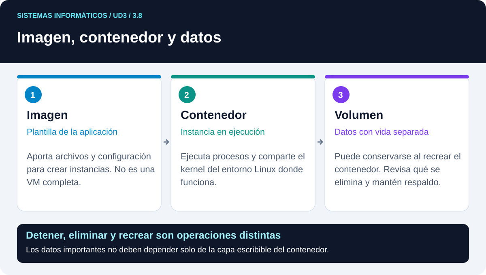

# 3.8 · Contenedores como conexión con DAM

3.8

**Contenedores para DAM**

Contenedores para DAM: explicación, ejemplos y comprobaciones.

## Imagen, contenedor y volumen

Una imagen es una plantilla para crear contenedores. Un contenedor es una instancia con procesos y una capa de escritura. Un volumen permite conservar datos con un ciclo de vida separado del contenedor. Una etiqueta ayuda a elegir imagen, pero puede cambiar de contenido; para máxima reproducibilidad se registra también su digest.

Un contenedor detenido puede conservar su capa de escritura hasta que se elimina. Al eliminarlo, no debes confiar en esa capa para conservar datos importantes. Un volumen no se borra simplemente por recrear el contenedor, pero también necesita respaldo si contiene información valiosa.

## Aplicación de aula

En [P7 · Contenedores](practicas/p7-contenedores.md) se ejecuta un servidor web dentro de la VM Ubuntu. La instalación del motor sigue la documentación oficial elegida por el docente; no se mezclan paquetes incompatibles ni se pega un script remoto sin revisarlo. Se utilizan comandos con sudo, sin añadir a toda la clase al grupo docker como si fuera un permiso ordinario.

Publicar 127.0.0.1:8081:80 hace accesible el puerto 80 del contenedor a través de 8081 en el bucle local de la VM. Desde el anfitrión físico, 127.0.0.1 identifica otro sistema; por eso la prueba inicial se hace con el navegador de Ubuntu. Esta distinción enlaza con las redes de UD4/P6.

## Qué comparar

Compara kernel, tiempo de preparación, espacio y persistencia. No concluyas que un contenedor equivale a instalar un sistema completo. Tampoco concluyas que siempre es más adecuado: para aprender el instalador y el arranque de Windows o Linux se necesita un sistema invitado completo. Las aplicaciones web son un contexto apropiado para explorar la alternativa de contenedores. Referencias F10 y F11.

## Interpretar la publicación de puertos

En `127.0.0.1:8081:80`, la primera parte es la dirección de escucha del sistema que ejecuta el motor, la segunda es su puerto publicado y la tercera el puerto del contenedor. En P7 el motor está dentro de Ubuntu virtualizado. El navegador de esa Ubuntu puede usar 127.0.0.1:8081; el del ordenador físico utiliza su propio bucle local y necesitaría otra ruta para llegar.

Esto permite razonar la diferencia entre que un proceso esté en ejecución y que un cliente pueda alcanzarlo. También explica por qué los datos del volumen pueden seguir presentes aunque se elimine el contenedor: servicio, red y almacenamiento tienen ciclos de vida relacionados, pero separados.

## Actividades de este apartado

Solo A1 y A10 tienen entrega propia. Las demás actividades son trabajo de aula o refuerzo, sin archivo ni calificación independiente. Las prácticas se entregan según el itinerario: P1, P2, P3, P4, P5, P6 y P7. Total: nueve entregas en UD3.

## Vídeo explicativo · Docker: explicación inicial

V7: observa la comparación de capas; la instalación del motor sigue el procedimiento de aula.

<iframe src="https://www.youtube-nocookie.com/embed/9eTVZwMZJsA" title="Docker: explicación inicial" loading="lazy" allowfullscreen></iframe>

[Abrir el vídeo en su página original](https://www.youtube.com/watch?v=9eTVZwMZJsA) · [Ficha y preguntas de visionado](videos.md)

## Práctica de este apartado · P7

Realiza [P7 · Contenedores: una web y sus datos persistentes](practicas/p7-contenedores.md). Es una práctica guiada de **dos horas, con entrega propia**, sobre un clon Ubuntu con Docker Engine preparado por el docente.

Publicarás nginx, modificarás su página, compararás el kernel y comprobarás la persistencia al eliminar y recrear el contenedor con el mismo volumen. Entrega `P7_Apellidos_Nombre.pdf` con capturas ordenadas del proceso, una explicación breve de cada paso, los identificadores de ambos contenedores, el digest y las comprobaciones indicadas en la ficha.
