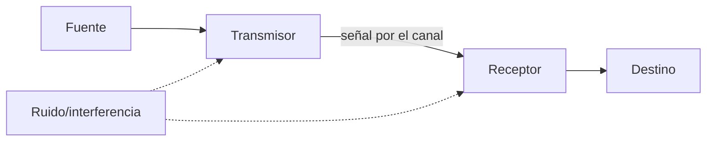
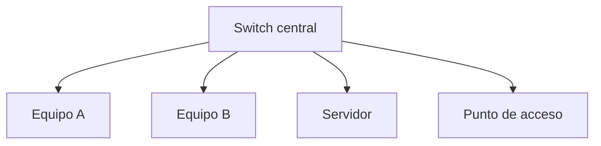

# 4.1 · Comunicación, medios y dispositivos

Una red permite que aplicaciones de equipos diferentes intercambien datos y compartan servicios. Para comprenderla, empezaremos por el recorrido de un mensaje: qué lo origina, cómo viaja y qué dispositivos intervienen. Al terminar podrás dibujar la red del aula y explicar qué seguiría funcionando si falla una parte.

Piensa en enviar un documento a una impresora del aula. El ordenador y la impresora son equipos finales; el cable o el enlace inalámbrico transporta señales; el switch conecta los puestos. Internet solo interviene si el servicio utilizado está fuera de la red local.

## 4.1.1 Elementos de comunicación

El mensaje debe codificarse en señales adecuadas al canal. En cobre son variaciones eléctricas; en fibra, luz; en Wi-Fi, ondas electromagnéticas. El receptor reconstruye bits, pero debe compartir protocolos y código.

El emisor prepara la información y el transmisor la convierte en señales. En el otro extremo, el receptor interpreta esas señales y entrega los datos al destino. Una tarjeta de red realiza parte de estas funciones. Un protocolo establece cómo se forman e interpretan los mensajes y qué respuestas se esperan.

En una impresión, el documento es el mensaje, el ordenador es el origen y la impresora es el destino. Ethernet o Wi-Fi permiten el intercambio local y el protocolo de impresión organiza la petición. Tener un cable conectado no basta: los participantes deben utilizar reglas compatibles.

## 4.1.2 Magnitudes

- **Ancho de banda:** capacidad nominal en bit/s.
- **Throughput:** datos útiles logrados.
- **Latencia:** tiempo de extremo a extremo.
- **Jitter:** variación de latencia.
- **Pérdida:** unidades que no llegan.

Copiar 1 GiB por un enlace de 100 Mbit/s no tarda 10 segundos. `1 GiB = 8.589.934.592 bits`; el mínimo teórico ronda 85,9 s y la sobrecarga aumenta el tiempo.

La capacidad y la latencia responden a preguntas distintas. Una conexión puede transportar muchos datos por segundo y tardar bastante en recibir la primera respuesta. En una videollamada también importan el jitter y las pérdidas: recibir audio de forma irregular puede resultar molesto aunque la velocidad nominal sea alta.

Para calcular un tiempo mínimo, convierte primero el tamaño a bits y divide por bit/s. Un byte contiene ocho bits. Mbit usa potencias decimales y GiB usa potencias de 1024. La transmisión real incluye cabeceras, esperas y límites de los equipos; el resultado teórico es un límite inferior, no una duración garantizada.

## 4.1.3 Medios guiados

El par trenzado reduce interferencia mediante torsión y transmisión diferencial. Categoría, longitud, conectores y calidad del montaje determinan prestaciones. Ethernet de cobre suele limitar el tramo horizontal a 100 m en condiciones estándar.

La fibra transmite luz, ofrece gran capacidad, distancia e inmunidad electromagnética. Monomodo y multimodo usan ópticas y alcances distintos; conectores y limpieza son críticos.

Elegimos el medio según distancia, entorno y necesidades. Para un puesto próximo al switch suele bastar par trenzado adecuado; para enlazar edificios o trabajar junto a interferencias puede convenir fibra. Hay que comprobar que ambos extremos admiten el mismo tipo de enlace: un cable de categoría superior no convierte un puerto de 100 Mbit/s en uno de 1 Gbit/s.

Un enlace de 1 Gbit/s del puesto al switch tampoco garantiza esa velocidad hasta Internet. Si el enlace de salida es más lento y lo comparten varios usuarios, puede convertirse en el cuello de botella.

## 4.1.4 Wi-Fi

Wi-Fi comparte medio: los clientes compiten por tiempo de aire. La velocidad anunciada es física y agregada; distancia, obstáculos, interferencias, canal, ancho y número de clientes reducen rendimiento.

Bandas de 2,4 GHz ofrecen alcance y congestión; 5/6 GHz aportan más canales y capacidad con menor penetración. La planificación usa mediciones, no solo intensidad de señal.

Un punto de acceso conecta clientes inalámbricos con una red. El nombre visible o SSID identifica una red anunciada, pero no indica por sí solo su capacidad ni su acceso a Internet. Dos aulas con buena cobertura pueden obtener resultados diferentes si una tiene muchos clientes transmitiendo simultáneamente.

Al diagnosticar Wi-Fi se distingue asociación al punto de acceso, configuración IP y acceso al servicio. El icono de conexión inalámbrica confirma solo parte del recorrido.

## 4.1.5 Topologías

La estrella facilita aislamiento de fallos de cable. Topología física describe conexiones; lógica, cómo circula información.

Si falla el cable de un puesto, el problema suele quedar en ese enlace. Si falla el switch central y no existe otro camino, se pierde la comunicación entre los equipos conectados a él. Si solo falla el enlace del router al proveedor, los equipos locales pueden seguir usando una impresora o servidor de la misma LAN.

Por eso, al dibujar una red, marca qué elemento conecta cada segmento y dónde está la salida. El dibujo permite razonar sobre el alcance de una avería antes de tocar la configuración.

## 4.1.6 Dispositivos

- Un **repetidor** regenera señal.
- Un **switch** aprende MAC y conmuta tramas.
- Un **router** decide siguiente salto entre redes IP.
- Un **punto de acceso** puentea clientes inalámbricos.
- Un **firewall** aplica política.
- Una **ONT/módem** adapta el acceso del proveedor.

En un equipo doméstico pueden convivir router, switch, punto de acceso y firewall en la misma carcasa. Son funciones diferentes: que el Wi-Fi siga encendido no demuestra que el encaminamiento o la conexión del proveedor funcionen. En el aula podemos tener dispositivos separados para cada función.

El switch utiliza direcciones MAC para reenviar tramas dentro del enlace; el router utiliza redes IP para elegir por dónde continuar. La puerta de enlace es la dirección del router que el equipo utiliza para alcanzar destinos externos cuando no dispone de una ruta más específica.

### Ejemplo

Un PC de una LAN quiere acceder a Internet. Envía la trama al MAC de la puerta de enlace, no al MAC del servidor remoto. El router elimina la trama local, examina IP y crea una nueva trama para el siguiente enlace.

## 4.1.7 Dúplex y conmutación

En full dúplex ambos extremos transmiten simultáneamente. En redes Ethernet con switches modernos no deberían existir colisiones en el enlace. Una discrepancia de velocidad o dúplex puede causar errores y rendimiento anómalo.

## Clasificar sin confundir criterios

PAN describe un entorno personal; LAN, una red local; MAN y WAN, ámbitos de interconexión más amplios. El alcance no se define únicamente por un límite rígido de edificio o ciudad. WLAN es una LAN inalámbrica: «local» y «Wi-Fi» son clasificaciones compatibles.

Cliente-servidor describe los papeles de una aplicación: un equipo solicita y otro presta un servicio. Una red puede tener varios servidores y un mismo equipo puede ser cliente de un servicio y servidor de otro. Entre iguales significa que los participantes pueden asumir ambos papeles; no obliga a que todos estén físicamente conectados con todos.

Simplex, half dúplex y full dúplex describen sentidos y simultaneidad de transmisión. Se aplican al enlace o mecanismo estudiado: «Internet es full dúplex» no sustituye al análisis de sus enlaces. Bus y anillo sirven como comparación histórica; la estrella con switches es el ejemplo inicial de aula.

Un hub repite señales hacia los demás puertos. Un switch aprende direcciones MAC y puede reenviar unicast por un solo puerto, pero también inunda broadcast y destinos desconocidos dentro del dominio correspondiente. No distribuye siempre todas las tramas a todos los equipos.

## Ejemplo razonado · La impresora funciona, Internet no

El PC A y la impresora están conectados al mismo switch y configurados en la misma subred. El router conecta esa LAN con el proveedor. Al desconectar únicamente el enlace exterior del router, A todavía puede enviar tramas locales a la impresora. La petición no necesita atravesar la conexión del proveedor.

Si la impresión dependiera de un servidor en la nube, el resultado podría cambiar. Para justificar una conclusión hay que indicar dónde se presta el servicio, además de dibujar cables.

**Comprueba que lo entiendes:** ¿qué diferencia habría entre desconectar el cable de A, apagar el switch y desconectar la salida del router? Señala los equipos afectados en cada caso.

## Vídeo de apoyo · Comunicación usando ordenadores · UPV

Vídeo en castellano de la Universitat Politècnica de València para situar la comunicación entre aplicaciones antes de analizar los dispositivos de la red.

<iframe src="https://www.youtube-nocookie.com/embed/fEy-TBMElso" title="Comunicación usando ordenadores · UPV" loading="lazy" allowfullscreen></iframe>

[Abrir el vídeo en YouTube](https://www.youtube.com/watch?v=fEy-TBMElso)

**Durante el visionado:** identifica quién solicita un servicio, quién lo presta y qué necesita circular entre ambos. Después traslada ese recorrido al caso de la impresora.

## Ahora aplica lo aprendido

[Actividad 4.1 + P1 · Comprender la red e inspeccionar la conexión](actividades/A1-red-del-aula.md).

Lee primero el encargo escrito y continúa con P1 en esa misma página. Entrega respuestas, tabla de parámetros y capturas comentadas en `UD4_A1_Codigo.pdf`, en una sola tarea de Aules.
