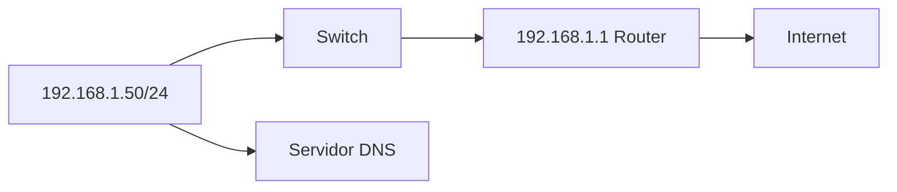
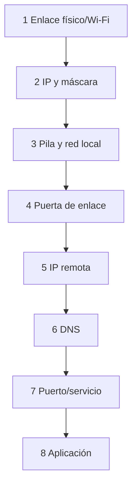

# 4.5 · Configuración y diagnóstico

Configurar una red significa dar a cada interfaz parámetros coherentes con la topología. Diagnosticar consiste en comparar lo esperado con lo observado y escoger una prueba que permita distinguir causas. Antes de ejecutar comandos, dibuja el recorrido y concreta qué comunicación debería funcionar.

## 4.5.1 Parámetros

Una interfaz necesita IP/prefijo. Para salir de la subred usa puerta de enlace. Para nombres usa DNS. DHCP puede proporcionar todo.

Cada parámetro tiene una función. La dirección identifica la interfaz; el prefijo permite reconocer destinos locales; la puerta de enlace da acceso a otras redes; el DNS ayuda a resolver nombres. Un valor correcto en un campo no compensa un error en otro.

| Parámetro | Ejemplo de aula | Qué permite comprobar |
| --- | --- | --- |
| IPv4/prefijo | `192.168.50.10/24` | Red conectada `192.168.50.0/24` |
| Puerta de enlace | `192.168.50.1` si existe ese router | Siguiente salto para destinos externos |
| DNS | Dirección facilitada por el docente | Resolución de los nombres del laboratorio |
| Asignación | Manual o DHCP | De dónde procede la configuración y cómo restaurarla |

Para conectar dos equipos de la misma subred en una LAN aislada bastan direcciones compatibles y únicas, enlace y permisos adecuados. No hay que inventar puerta ni DNS si esos servicios no existen.



La puerta debe pertenecer a una red directamente conectada; de lo contrario el equipo no sabe cómo alcanzarla.

## 4.5.2 Inspección

Inspeccionar es consultar el estado actual sin cambiarlo. Empieza identificando el adaptador de laboratorio: un equipo puede mostrar Ethernet, Wi-Fi, VPN y adaptadores virtuales. Mezclar la dirección de uno con la puerta de otro produce un informe incoherente.

En la salida de direcciones localiza IPv4 y prefijo. En la tabla de rutas diferencia una ruta a la red conectada de la ruta por defecto. La consulta de vecinos muestra asociaciones locales entre IP y MAC; no es una lista de todos los servidores alcanzables por Internet. Los puertos en escucha corresponden al propio equipo, no prueban por sí solos el acceso desde otro puesto.

Linux:

```bash
ip -br address
ip route
resolvectl status
ip neigh
ss -tulpen
```

Windows:

```powershell
Get-NetIPConfiguration
Get-NetRoute -AddressFamily IPv4
Get-DnsClientServerAddress
Get-NetNeighbor
Get-NetTCPConnection -State Listen
```

## 4.5.3 Diagnóstico por escalones



No se empieza reinstalando. Se localiza la primera prueba que falla.

Antes de cada prueba escribe qué esperas y qué podrías concluir. Que falle una prueba no autoriza a saltar directamente a una causa: una puerta que no responde a ICMP podría seguir reenviando paquetes. La secuencia orienta la investigación, pero sus resultados deben interpretarse junto con la política de filtrado y el servicio probado.

| Observación | Hipótesis inicial | Prueba que aporta información |
| --- | --- | --- |
| Solo un puesto falla | Interfaz, cable o parámetros del puesto | Comparar enlace y configuración con el plan |
| Todos pierden Internet, pero la impresora local funciona | Salida común o proveedor | Revisar la ruta y el estado del enlace de salida |
| El nombre no resuelve | Configuración DNS o servicio de resolución | Consulta DNS explícita y revisión del servidor configurado |
| El nombre resuelve, pero la aplicación falla | Transporte, TLS o servicio | Prueba al puerto y revisión de la respuesta de aplicación |

Una prueba a loopback confirma parte de la pila local; no comprueba el cable. Una prueba a un host de la LAN tampoco demuestra que exista ruta hacia otra red.

## 4.5.4 Herramientas

Ejecuta únicamente las herramientas disponibles y contra destinos autorizados del laboratorio. Sustituye los valores de ejemplo por el plan que indique el docente. `ping` prueba respuestas ICMP; `Resolve-DnsName` o `dig` consultan DNS; `Test-NetConnection -Port` prueba apertura TCP; `curl` solicita una respuesta de aplicación.

`tracert` y `tracepath` ayudan a observar saltos, pero un asterisco o un salto sin respuesta no demuestra por sí solo una interrupción del tráfico. Algunos equipos filtran respuestas de diagnóstico. No hace falta instalar todas las herramientas para interpretar los registros facilitados.

```bash
ping -c 4 127.0.0.1
ping -c 4 192.168.1.1
tracepath example.com
dig example.com
curl -v https://example.com/
nc -vz example.com 443
```

```powershell
Test-Connection 192.168.1.1 -Count 4
tracert example.com
Resolve-DnsName example.com
Test-NetConnection example.com -Port 443
```

## 4.5.5 Interpretación

- Sin enlace: cable, puerto, adaptador, Wi-Fi o controlador.
- `169.254.x.x`: dirección de enlace local; puede indicar autoconfiguración por falta de respuesta DHCP, aunque también puede haberse configurado expresamente.
- Gateway responde, IP remota no: ruta, proveedor o filtrado.
- IP remota responde, nombre no: DNS.
- Nombre resuelve y ping funciona, puerto no: servicio o firewall.
- Puerto abre, aplicación falla: protocolo, TLS, autenticación o aplicación.

Son pistas para formular hipótesis. Un equipo puede filtrar ICMP y servir HTTPS
correctamente; por tanto, un `ping` fallido no demuestra que esté apagado ni
que la ruta esté rota. Si un nombre resuelve pero no responde al ping, comprueba
el puerto y la aplicación antes de atribuir el fallo a DNS.

## 4.5.6 Captura

Wireshark permite ver tramas. Se captura con autorización y filtro mínimo. Ejemplo de un acceso web:

1. ARP para localizar gateway.
2. DNS para resolver nombre.
3. SYN/SYN-ACK/ACK a 443.
4. negociación TLS.
5. intercambio HTTP cifrado.

Este recorrido supone una conexión nueva, IPv4 y HTTPS sobre TCP. Las cachés
pueden evitar ARP o DNS visibles, y HTTP/3 utiliza QUIC sobre UDP. Una captura
no tiene por qué mostrar todas esas fases en cada petición.

La captura puede contener datos sensibles. Se limita, anonimiza y no se publica sin revisar.

## Caso completo

Un PC accede por IP pero no por nombre. `Get-NetIPConfiguration` muestra DNS antiguo. `Resolve-DnsName` agota tiempo. Se configura el DNS correcto mediante DHCP, se renueva concesión, se limpia caché y se verifica. Cambiar navegador no habría corregido la capa afectada.

## Documentación de incidencia

Registrar síntoma, alcance, topología, hora, comandos y salidas relevantes, hipótesis, cambio, resultado y prevención. Una captura sin explicación no es una memoria técnica.

Una evidencia útil muestra el destino, la prueba, su resultado y la conclusión limitada que permite obtener. Recorta la información ajena al ejercicio, pero conserva el contexto necesario para interpretar el resultado. Si el docente facilita salidas, indícalo: analizar un caso preparado es distinto de haber ejecutado tú el cambio.

En una tabla de incidencia registra primero la configuración inicial y la forma de recuperarla. Cambia una sola variable autorizada, repite la prueba y compara. Al terminar restaura los valores originales y comprueba el servicio que funcionaba al comienzo.

## Del ajuste gráfico a la evidencia

Antes de guardar cambios, identifica interfaz y perfil. Registra si el origen es DHCP o manual; cambiar a manual sin recordar puerta y DNS puede interrumpir la conexión. Usa una interfaz de laboratorio y conserva el plan de restauración. En Windows puedes consultar Configuración → Red e Internet → propiedades de la conexión; en Ubuntu Desktop, Configuración → Red → opciones de la conexión → IPv4.

Una LAN aislada entre dos equipos del mismo prefijo puede funcionar sin puerta ni DNS. Para consultar un nombre hace falta un mecanismo de resolución; para llegar a otra red hace falta una ruta. Ninguno se crea por escribir un valor cualquiera en la interfaz gráfica.

Fuente: [Microsoft · Get-NetIPConfiguration](https://learn.microsoft.com/en-us/powershell/module/nettcpip/get-netipconfiguration).

## Caso explicado · Hay dirección, pero no resolución

El equipo tiene `192.168.50.10/24`, alcanza el servicio interno de prueba por su IP y una consulta al nombre facilitado termina por tiempo agotado. La configuración muestra un DNS que no coincide con el plan.

1. Se comprueba que la IP usada corresponde al servicio esperado. Así se demuestra conectividad con ese destino concreto, no con cualquier servidor.
2. Se revisa el servidor DNS configurado y se repite una consulta explícita. El fallo es compatible con un problema de resolución; todavía podría haber filtrado o un servidor caído.
3. Se propone recuperar los parámetros DNS autorizados. Si proceden de DHCP, el docente decide cómo actualizar la concesión sin cortar conexiones de gestión.
4. Tras el cambio se repiten consulta y acceso por nombre. Si ambos funcionan, queda documentada la mejora. Finalmente se restaura el laboratorio según el encargo.

**Comprueba que lo entiendes:** si DNS devuelve la dirección correcta, falla ping y responde TCP 443, ¿qué has demostrado? La resolución y el establecimiento TCP funcionan; el ping fallido no demuestra que la web esté caída. Falta verificar la respuesta de aplicación.

## Vídeo de apoyo · Configuración de red en Windows · EducaMadrid

Demostración docente en castellano sobre configuración de red en Windows 10. Sirve para comparar asignación automática, parámetros manuales y consultas; los menús pueden diferir en Windows 11. Observa el procedimiento y utiliza los valores del laboratorio, no los del vídeo.

[Ver el vídeo en el portal de su autor](https://mediateca.educa.madrid.org/video/rcp774etrsjbj73q)

**Durante el visionado:** localiza dirección, máscara, puerta y DNS. Explica qué dato guardarías antes de cambiar a manual y cómo comprobarías la restauración.

## Ahora aplica lo aprendido

[Actividad 4.6 + P2, P3 y P5 · Configurar, comprobar y diagnosticar](actividades/A6-diagnostico-y-red-virtual.md).

Empieza por P2 y P3 después de esta explicación. Tras estudiar el bloque de redes virtuales, completa las decisiones de la actividad y P5. Todas las partes se conservan en `UD4_A6_Codigo.pdf` y se entregan juntas en la misma tarea de Aules.
