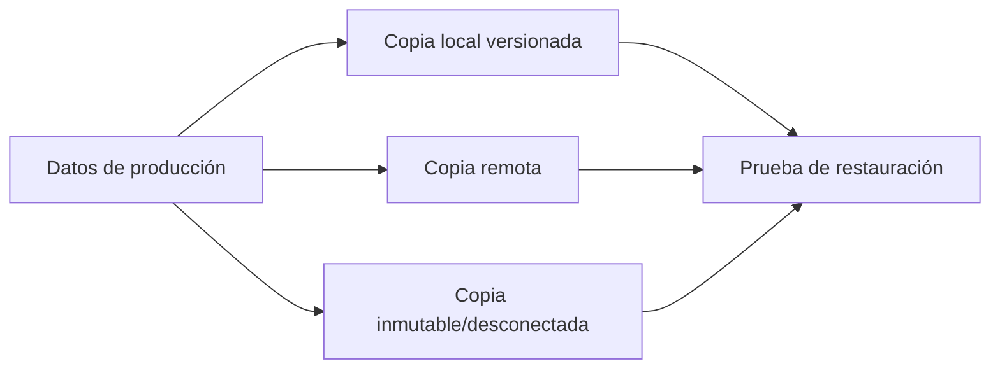

# 4. Copias, integridad y recuperación

## 4.1 Amenazas

Borrado accidental, fallo físico, corrupción, ransomware, robo, incendio y error de configuración requieren controles diferentes. RAID mejora disponibilidad frente a ciertos fallos de disco, pero no conserva históricos ni protege de borrados.

## 4.2 Estrategia 3-2-1-1-0

- 3 copias de los datos;
- 2 soportes o tecnologías;
- 1 copia fuera de la ubicación;
- 1 copia inmutable, desconectada o aislada;
- 0 errores tras verificación.



## 4.3 Tipos

Una completa simplifica restauración y consume más. Una incremental reduce ventana y espacio, pero necesita cadena. Una diferencial crece desde la última completa y requiere dos conjuntos para restaurar.

Ejemplo semanal:

- domingo: completa;
- lunes–sábado: incrementales;
- retención: cuatro semanales y doce mensuales.

La política se ajusta a RPO, RTO, capacidad y regulación.

## 4.4 Integridad y autenticidad

Una suma detecta cambios. Para demostrar origen se usa firma o MAC con claves controladas. El cifrado protege confidencialidad, pero perder la clave hace inútil la copia.

Se registran tamaño, suma, fecha, herramienta, versión, origen y destino.

## 4.5 Restauración

Plan:

1. Definir escenario y punto de recuperación.
2. Preparar destino aislado.
3. Recuperar copia completa y dependencias.
4. Aplicar incrementales o diferencial.
5. Verificar sumas, permisos y propietarios.
6. Arrancar aplicación o abrir datos.
7. Medir tiempo y documentar incidencias.

Una prueba que solo comprueba que el archivo de copia existe no valida recuperación.

## 4.6 Robocopy

```powershell
robocopy C:\Datos D:\Backup\Datos /MIR /COPY:DAT /DCOPY:T /R:2 /W:5 /LOG:D:\Backup\backup.log
```

`/MIR` replica borrados. Se usa con destino dedicado y se revisa con `/L` para simular:

```powershell
robocopy C:\Datos D:\Backup\Datos /MIR /L
```

El espejo facilita mantener una réplica, pero no aporta versiones históricas.
`/COPY:DAT` copia datos, atributos y marcas temporales; no conserva por sí solo
las ACL NTFS. Si se necesitan permisos y propietarios, hay que elegir opciones
y privilegios adecuados y comprobarlos al restaurar.

Robocopy usa códigos de salida propios: un valor de **8 o mayor** indica al
menos un fallo de copia. Los valores inferiores pueden señalar archivos
copiados, diferencias o elementos adicionales; deben interpretarse junto al
registro. En PowerShell se consulta `$LASTEXITCODE` inmediatamente después de
la orden. [Referencia de Robocopy](https://learn.microsoft.com/en-us/windows-server/administration/windows-commands/robocopy/).

## 4.7 Ejemplo resuelto: RPO, RTO y cadena de copias

**RPO** es la pérdida de datos máxima tolerable, medida en tiempo. **RTO** es el
tiempo objetivo para recuperar el servicio tras la interrupción. Son requisitos
que se acuerdan antes de elegir la herramienta.

Una aplicación necesita RPO de 4 horas y RTO de 2 horas. Hay una copia completa
el domingo a las 00:00 y copias incrementales cada 4 horas. Si falla el martes
a las 11:00 y la última copia válida terminó a las 08:00, se perderían hasta
3 horas de cambios. Se cumple el RPO en ese escenario; si esa copia falló y
solo es válida la de las 04:00, la pérdida sería de 7 horas y no se cumpliría.

Para restaurar una cadena incremental tradicional se necesitan la completa y
todas las incrementales necesarias hasta el punto elegido. Con una diferencial
se necesitan la completa y la última diferencial. La herramienta puede usar
otro esquema interno: se comprueba su procedimiento de restauración.

Supongamos 15 minutos para preparar el destino, 55 para recuperar, 20 para
validar datos y 10 para reabrir el servicio: `15 + 55 + 20 + 10 = 100 minutos`.
Está dentro de las 2 horas previstas. Medir solo la transferencia de archivos
habría omitido 45 minutos del trabajo de recuperación.

### Ensayo de restauración de un archivo

1. Crea un documento de prueba y registra su suma SHA-256.
2. Inclúyelo en una copia y modifica después el original.
3. Restaura la versión anterior en **otra carpeta**.
4. Compara la suma con la registrada, abre el documento y revisa permisos.
5. Anota copia utilizada, hora de inicio, hora de fin y resultado.

La suma demuestra coincidencia de bytes con la referencia; no demuestra que
una base de datos abierta se haya copiado en un estado coherente. Para ella
se necesita un procedimiento de copia compatible con la aplicación.

## Caso de incidente

Un usuario cifra accidentalmente archivos sincronizados. El espejo también replica cambios. Se aísla el origen, se determina el último punto sano, se restaura una versión inmutable a una ubicación alternativa, se valida con usuarios y solo entonces se sustituye producción.

## Criterios de aceptación

- RPO y RTO definidos.
- Copia fuera del dominio de credenciales ordinario.
- Cifrado y claves gestionados.
- Alertas ante fallo.
- Restauración parcial y completa ensayadas.
- Evidencia de la última prueba.
